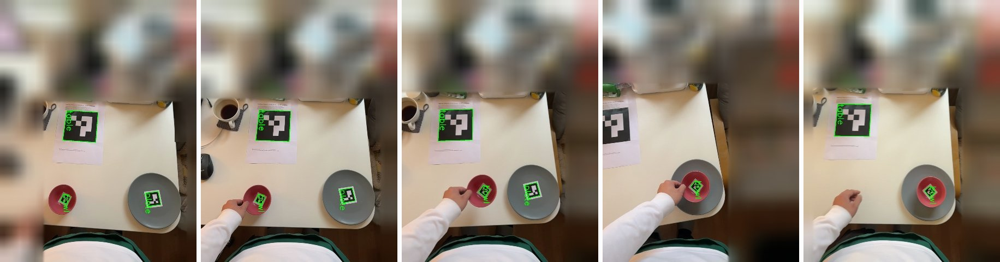
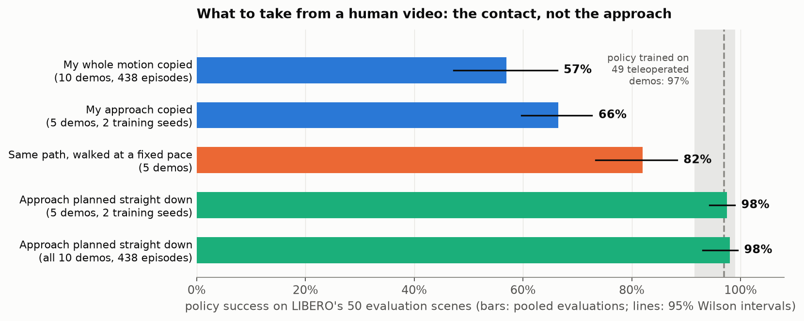
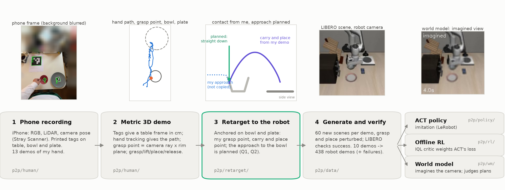
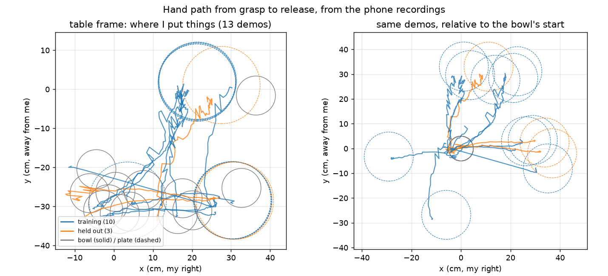

I recorded my own hand putting a bowl on a plate with an iPhone. Each recording becomes a metric 3D demonstration, is retargeted to a Franka Panda in the LIBERO simulator (LIBERO-Goal, *"put the bowl on the plate"*), and is multiplied into hundreds of robot demonstrations, each checked by the simulator. On that data I train an imitation policy (ACT), test whether offline RL can learn from the failed attempts, and test whether a world model can judge plans before they run.

**The question running through the project: what exactly should be transferred from a human video?** The short answer is the contact (where the hand grasps the bowl, how it carries it, and where it sets it down), not the path the hand took to get there.



## Results at a glance

| Question | Answer | Result (95% Wilson intervals) |
|---|---|---|
| What should be transferred from a human video? | The contact: where to grasp, how to carry, where to place. Plan the approach instead of copying it. | Copied motion 57% [47–66] → planned approach **98% [93–99]**. Teleoperated demos: 97% [92–99]. |
| How should a demo be retargeted to the robot's scene? | Relative to the objects. Replaying the hand path in fixed coordinates never works. | Absolute 0% [0–2], object-relative 81% [76–85], intent only 100% [99–100]. |
| How can you tell whether demos are learnable? | Train one policy, then run it while averaging its overlapping action predictions. Unlearnable demos collapse. | 92–100% for policies on learnable demos, 12–48% on my copied approach (12 runs). |
| Does learning from failed rollouts help? | Not measurably. The critic's weights moved failures from grasping to placing. | IQL-weighted 64% [54–73], unweighted 60% [50–69], successes only 57% [47–66]. |
| Can a world model judge a plan before execution? | It judges an action sequence well, but cannot yet pick the best plan before acting. | Success AUROC 0.93; choosing among 13 plans 78% [65–87] vs 71% at random. |

Policy success is measured on LIBERO's 50 fixed evaluation scenes, which were never used to generate training data.

## Pipeline

An iPhone records RGB, LiDAR depth, and camera pose, and printed tags give a metric table frame. Hand tracking yields the hand path; the grasp point comes from the camera ray through the pinch intersected with the bowl's rim plane, because the fingers are hidden exactly at the moment of grasping. Retargeting anchors my grasp, carry, and place point on the robot's bowl and plate and plans the approach. Each demo is then replayed in 60 fresh scenes with the objects shifted and the grasp and place points perturbed, and the simulator decides success: 600 rollouts become 438 verified demos.

## Data

I made 25 recordings. 13 pass every check and form the main set: 10 for training and 3 held out, chosen before any training. The bowl started in many places and the plate in a few, which is why replaying in fixed coordinates cannot work.

## What I learned

1. **Express the demonstration relative to the objects, not the room.** No two recordings had the bowl and plate in the same place. Anchoring the same path on the objects took replay success from 0% to 81%.
2. **Take the contact, plan the free motion.** The robot could replay my approach to the bowl, but a policy trained on it closed the gripper beside the rim instead of on it. The same data with a straight-down approach gave 98%.
3. **Check that the human's choices suit the robot.** My natural grasp took the bowl on sides the arm handles badly in this scene, so the recordings followed a simple protocol. The simulator catches such mismatches, but only if every generated episode is checked.
4. **Let the simulator multiply and verify, but it won't fix bad data.** Ten demos became 438 verified episodes. Nine times more data of the copied kind moved the policy only from 46% to 57%.
5. **Fix what the policy imitates before tuning how it learns.** Offline RL, corrective noise, and three times longer training all left the policy where it was. Changing the motion it had to copy closed the gap.

The full write-up, including the offline-RL and world-model analyses, is in the [repository README](https://github.com/LukasWill/phone2panda).
