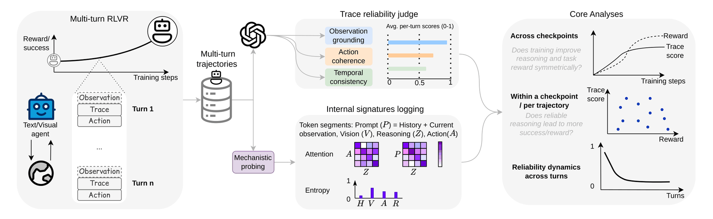
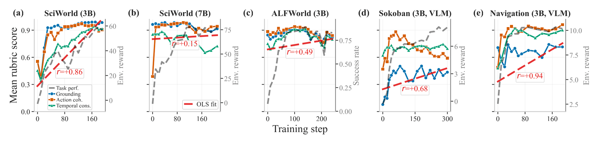

## The question

RL from verifiable rewards (RLVR) reliably raises task success. It does not follow that the visible reasoning gets better: a high-reward trajectory can describe a state that isn't there, take an action its own reasoning argues against, or ignore what the last turn revealed. TraceRigor treats trace reliability as a measured quantity next to reward.

## What I built

- **Multi-turn RLVR training.** Service-backed environments, a multi-turn rollout manager with turn-level loss and GAE masks, and PPO/GRPO with bi-level, turn-wise, and masked GAE for turn-level credit assignment. Training runs on a veRL fork ([verl-tracerigor](https://github.com/LukasWill/verl-tracerigor)) with asymmetric clipping (0.2 / 0.28) and dual-clip (3.0), orchestrated with Ray and 128 environments per step.
- **A two-layer trace judge.** Deterministic checks (format, out-of-action-space, repetition, empty reasoning) settle the obvious failures before any LLM call. The remaining turns go to an LLM judge on any OpenAI-compatible endpoint, such as a self-hosted vLLM server, with JSON-schema guided decoding, rate limiting, retries, and audit logs.
- **Ground truth for the judge.** Sokoban prompts carry simulator-derived spatial relations, and ScienceWorld has mechanical checks and trajectory replay. On 465 doubly annotated turns, judge labels agree with independent human labels at least 79% of the time in every modality and rubric.
- **Nine environment integrations.** ALFWorld, ScienceWorld, Sokoban, AI2-THOR Navigation, ManiSkill PrimitiveSkill, BabyAI-Text, FrozenLake, Blackjack, and SVG reconstruction. The CPU path runs end to end in CI.

## What we found

1. **Across training, performance and reliability rise together.** ALFWorld success climbs from 8.6% to 85.2%, and SciWorld-3B reward from −8.0 to +60.5. Rubric scores also rise, but not monotonically. The weakest rubric depends on modality: temporal consistency for long-horizon text agents, observation grounding for visual agents.
2. **Within a checkpoint, the winners are barely more reliable.** The length-controlled reliability gap between high- and low-performing trajectories is about 0.1 on a 0–1 scale. A randomly drawn high performer is more reliable than a low performer only 55–70% of the time.
3. **Reliability decays over an episode, even in successful ones.** ALFWorld shows the strongest decline in temporal consistency (mean within-trajectory ρ = −0.27).
4. **Agents act coherently on false beliefs.** Across 37,960 audited turns, 56.9% of Sokoban turns follow a false premise coherently, and 25.2% of ScienceWorld turns contain unsupported progress claims.

## Why it matters for post-training

Reward curves alone can't show whether a policy learned the right thing. TraceRigor measures it, and the same checker can turn its scores into process rewards that shape training.

[Paper]() · [Code](https://github.com/LukasWill/tracerigor)
